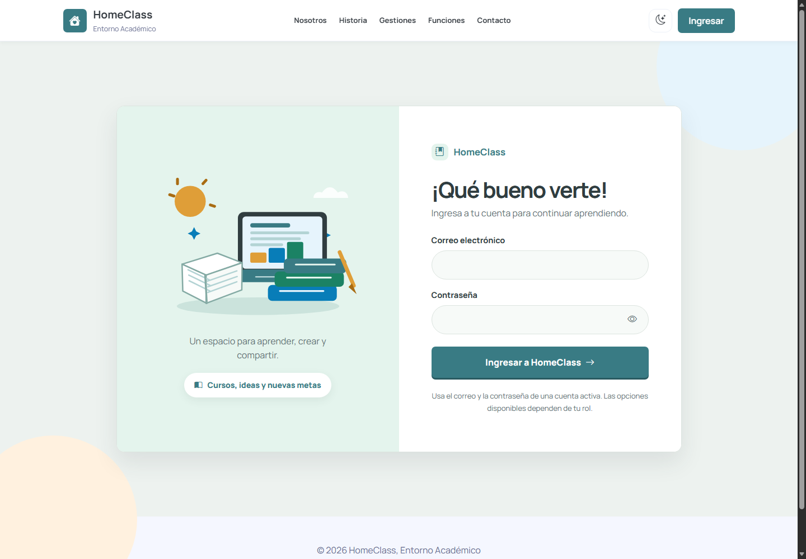

# Informe técnico: integración del frontend con el backend

- **Proyecto:** HomeClass
- **Fecha:** 27 de noviembre de 2026
- **Alcance:** adaptación del frontend; backend sin modificaciones.

## 1. Resumen ejecutivo

Se revisaron los contratos de la Minimal API activa y se adecuó el frontend para consumir las rutas que realmente publica. El cliente HTTP ahora contempla autenticación por credenciales, usuarios y perfiles, recuperación de contraseña, mensajería, foros, publicaciones y notificaciones. La pantalla de mensajes quedó conectada a los DTO y rutas de comunicación del backend.

La API activa no ofrece endpoints para cursos, dashboard, categorías ni contenido LMS. Por ello, esas pantallas no se presentan como funciones operativas en la navegación actual. No se simularon respuestas ni se modificó el backend para completar esas capacidades.

## 2. Alcance y criterios

- Los cambios se limitaron a `Frontend/`.
- Los métodos, rutas, cuerpos y respuestas se contrastaron con los endpoints y DTO actuales del backend.
- Se conservaron únicamente flujos respaldados por rutas reales; las capacidades no disponibles se dejaron fuera de la navegación.
- La integración no agrega autenticación o autorización en el frontend que el backend no proporcione.

## 3. Hallazgos sobre el contrato del backend

La implementación actual difiere del contrato que esperaba el cliente previo:

1. El login está en `POST /api/usuarios/login` y recibe `{ correo, password }`.
2. La respuesta del login contiene `{ id, rolId, rolNombre, correo, activo }`; no incluye `{ token, usuario }`.
3. Las rutas de mensajería están bajo `/api/mensajes-privados`, no bajo `/api/mensajes`.
4. El backend publica rutas de usuarios, perfiles docente/estudiante, recuperación, foros, publicaciones y notificaciones.
5. No publica rutas de cursos, catálogo, dashboard, secciones, lecciones o progreso académico.

Los contratos detallados se mantienen en [`API.md`](./API.md).

## 4. Implementación realizada

### 4.1 Cliente HTTP

[`src/api/http.js`](../src/api/http.js) centraliza las solicitudes `fetch` y expone los métodos disponibles por dominio. Serializa cuerpos JSON, procesa respuestas `204` y muestra mensajes de error que pueden llegar como `mensaje`, `detail` o `title`. Se retiró el encabezado Bearer: el backend actual no emite ni consume ese token.

### 4.2 Login y estado de usuario

[`src/context/AuthContext.jsx`](../src/context/AuthContext.jsx) envía las credenciales con los nombres esperados por el DTO del backend y adapta los roles `Administrador`, `Docente` y `Estudiante` a los identificadores internos del frontend.

Como el login no devuelve una credencial de sesión, [`src/api/sesion.js`](../src/api/sesion.js) conserva el perfil en `sessionStorage` solo para mantener el estado de interfaz de esa pestaña. Este perfil no valida solicitudes posteriores ni equivale a una sesión autenticada.

### 4.3 Mensajería

[`src/pages/Mensajes.jsx`](../src/pages/Mensajes.jsx) utiliza los contratos reales:

| Acción | Método y ruta |
|---|---|
| Cargar destinatarios | `GET /api/usuarios/` |
| Cargar mensajes recibidos | `GET /api/mensajes-privados/recibidos/{receptorId}` |
| Enviar mensaje | `POST /api/mensajes-privados/` |
| Marcar como leído | `PATCH /api/mensajes-privados/{id}/leer` |

El envío incluye `emisorId`, `receptorId`, `asunto` y `contenido`. La vista consume los campos `emisorNombre` y `fechaEnvio` del DTO de mensajes recibidos.

### 4.4 Navegación y capacidades disponibles

[`src/App.jsx`](../src/App.jsx), [`src/layouts/AppLayout.jsx`](../src/layouts/AppLayout.jsx) y [`src/pages/PanelLms.jsx`](../src/pages/PanelLms.jsx) limitan el panel a las funciones compatibles con las rutas actuales. Cursos y categorías ya no aparecen como opciones operativas. Se añadió estilo para el aviso informativo en [`src/styles.css`](../src/styles.css).

### 4.5 Configuración de conexión

[`vite.config.js`](../vite.config.js) reenvía `/api` al valor de `VITE_PROXY`, cuyo valor predeterminado es `http://localhost:5296`, según el perfil HTTP de `launchSettings.json`. [`.env.example`](../.env.example) contiene la configuración de referencia; debe copiarse a `.env` para personalizar el entorno local. `VITE_API_URL` permanece en `/api`.

## 5. Matriz de compatibilidad

| Área | Estado en el frontend | Observaciones |
|---|---|---|
| El panel tenía solo dos tarjetas genéricas y no destacaba los cursos ni las opciones disponibles por perfil. | [PanelLms.jsx](../src/pages/PanelLms.jsx) | El resumen ahora presenta el total de cursos, los publicados, la sesión activa, cursos reales y accesos rápidos. Las categorías solo aparecen para administración. |
| La navegación autenticada no indicaba claramente la página actual ni seguía el estilo de la plantilla. | [AppLayout.jsx](../src/layouts/AppLayout.jsx) y [styles.css](../src/styles.css) | Se aplicaron la barra lateral oscura, el encabezado superior, los acentos índigo/turquesa, tarjetas claras y ajustes para pantallas pequeñas. |
| Había pantallas antiguas con llamadas API que no existen en el cliente HTTP activo. Por ejemplo, asistencia y evaluaciones llaman a `api.asistencia` y `api.evaluaciones`, que no están en [http.js](../src/api/http.js). | [Asistencia.jsx](../src/pages/docente/Asistencia.jsx), [Evaluaciones.jsx](../src/pages/docente/Evaluaciones.jsx) | No se añadieron al menú ni se anuncian como funciones listas; primero necesitan rutas del backend y persistencia compatible. |
| Algunos controladores antiguos usan tablas `dbo.*`, pero no se incluyen en el proyecto web compilado. | [HomeClassApi.csproj](../../Backend/HomeClassApi/HomeClassApi.csproj) y [AcademicoController.cs](../../Backend/HomeClassApi/Controllers/AcademicoController.cs) | El menú ofrece solamente las capacidades del controlador activo [LmsController.cs](../../Backend/HomeClassApi/Controllers/LmsController.cs), conectado a los esquemas `Usuarios`, `Academico`, `Contenido` y `Comunicacion`. |
| La referencia visual Kapella usa índigo, turquesa y superficies claras; la interfaz tenía otra paleta y una barra lateral clara. | Comparación con la plantilla de referencia. | Los tokens globales y estilos del panel se ajustaron a esos colores, conservando el tema oscuro existente. |
| La portada mezclaba demasiados detalles y las secciones del menú no tenían suficiente información propia. | [Inicio.jsx](../src/pages/Inicio.jsx), [Publicas.jsx](../src/pages/Publicas.jsx), [Audiencias.jsx](../src/components/Audiencias.jsx), [Historia.jsx](../src/components/Historia.jsx), [Gestiones.jsx](../src/components/Gestiones.jsx), [Features.jsx](../src/components/Features.jsx) | Se mantuvo una introducción breve con enlaces de resumen y se amplió cada sección en su ruta independiente. Historia explica el propósito sin inventar fechas; Funciones y Gestiones describen solo capacidades respaldadas por la API; Contacto ofrece pasos de soporte sin inventar datos de contacto. |
| El catálogo no permitía encontrar cursos rápidamente. | [Cursos.jsx](../src/pages/Cursos.jsx) | Se agregó búsqueda local sobre los cursos recibidos desde la API y una presentación de tarjetas basada en su información real. |
| El ingreso ocultaba la navegación pública y usaba colores distintos a la identidad actual. | [Ingresar.jsx](../src/pages/Ingresar.jsx), [PublicLayout.jsx](../src/layouts/PublicLayout.jsx) | Se restauró la barra superior y se armonizó el formulario con la paleta HomeClass. La ilustración original de libros, cuaderno y computadora se adapta a claro y oscuro. |
| MSBuild no encontraba las referencias de .NET Framework 4.8 al compilar la API. | La compilación se detenía con MSB3644. | Se restauraron las referencias `Microsoft.NETFramework.ReferenceAssemblies.net48` y se compiló indicando su ruta como `FrameworkPathOverride`. La API inició en IIS Express en `localhost:5000`. |

## Opciones conectadas que muestra el frontend

- **Todos los perfiles:** resumen, cursos visibles por perfil, detalle del curso, contenido, foros y mensajes privados.
- **Estudiante:** actualización del progreso de lecciones desde el detalle del curso.
- **Docente:** cursos propios y creación/moderación de foros.
- **Administración:** catálogo global, matrículas y gestión de categorías/subcategorías.

Las pantallas de asistencia, calificaciones, evaluaciones/entregas, materiales, auditoría y gestión de usuarios no se exponen como opciones operativas: sus llamadas no están en la API activa. La base incluye algunos scripts parciales de evaluaciones, pero falta la tabla padre `Evaluaciones.evaluaciones`; véase [evaluaciones.sql](../../DB/Datos/Tablas/Evaluaciones/evaluaciones.sql).

El login sí acepta cualquiera de las cuentas activas ya registradas, siempre con su contraseña real; no filtra por rol. Las cuentas nuevas no se crean desde la interfaz activa, porque el módulo antiguo de usuarios no está conectado al esquema actual.

## Capturas

Portada final de HomeClass, servida localmente; muestra el resumen y los enlaces a las páginas independientes:

Formulario de ingreso con la navegación superior y la paleta del sitio:

## Validación

- `npm ci`: dependencias instaladas desde el lockfile. npm informó 4 vulnerabilidades en dependencias (3 moderadas y 1 alta); no se aplicó una actualización forzada porque no es parte del rediseño.
- `npm run build`: correcto; Vite generó el paquete de producción con el nuevo diseño.
- La API compiló correctamente y quedó ejecutándose en `http://localhost:5000`; el frontend respondió en `http://127.0.0.1:5173/`.
- El endpoint de login devolvió `401` esperado para un correo inexistente, tanto directamente como por el proxy del frontend.
- Con autorización, se restablecieron las contraseñas temporales de administración, docencia y estudiante; se verificaron los tres accesos y sus roles por la API, y se cerraron las sesiones de prueba. Las claves no se guardan en este informe.
- Se verificaron la navegación superior, la composición de escritorio y el ajuste móvil, el control para mostrar/ocultar la contraseña y el mensaje de error del login.
- La compilación de producción posterior a la reorganización pasó con `npm run build`. Se recorrieron las rutas `/`, `/nosotros`, `/historia`, `/gestiones`, `/funciones` y `/contacto` en un viewport móvil de 390 px; ninguna presentó desbordamiento horizontal.
