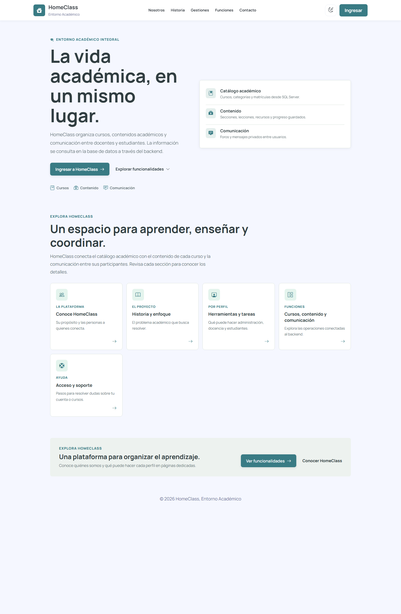

# Informe de errores y soluciones

## Alcance

Se revisaron las rutas, las llamadas HTTP y los controladores activos. La portada conserva su presentación breve y dirige a páginas independientes para Nosotros, Historia, Gestiones, Funciones y Contacto. El contenido describe las operaciones conectadas sin inventar cursos, precios, reseñas ni métricas.

## Errores encontrados y correcciones

| Hallazgo | Evidencia | Solución aplicada |
|---|---|---|
| El panel tenía solo dos tarjetas genéricas y no destacaba los cursos ni las opciones disponibles por perfil. | [PanelLms.jsx](../src/pages/PanelLms.jsx) | El resumen ahora presenta el total de cursos, los publicados, la sesión activa, cursos reales y accesos rápidos. Las categorías solo aparecen para administración. |
| La navegación autenticada no indicaba claramente la página actual ni seguía el estilo de la plantilla. | [AppLayout.jsx](../src/layouts/AppLayout.jsx) y [styles.css](../src/styles.css) | Se aplicaron la barra lateral oscura, el encabezado superior, los acentos índigo/turquesa, tarjetas claras y ajustes para pantallas pequeñas. |
| Había pantallas antiguas con llamadas API que no existen en el cliente HTTP activo. Por ejemplo, asistencia y evaluaciones llaman a `api.asistencia` y `api.evaluaciones`, que no están en [http.js](../src/api/http.js). | [Asistencia.jsx](../src/pages/docente/Asistencia.jsx), [Evaluaciones.jsx](../src/pages/docente/Evaluaciones.jsx) | No se añadieron al menú ni se anuncian como funciones listas; primero necesitan rutas del backend y persistencia compatible. |
| Algunos controladores antiguos usan tablas `dbo.*`, pero no se incluyen en el proyecto web compilado. | [HomeClassApi.csproj](../../Backend/HomeClassApi/HomeClassApi.csproj) y [AcademicoController.cs](../../Backend/HomeClassApi/Controllers/AcademicoController.cs) | El menú ofrece solamente las capacidades del controlador activo [LmsController.cs](../../Backend/HomeClassApi/Controllers/LmsController.cs), conectado a los esquemas `Usuarios`, `Academico`, `Contenido` y `Comunicacion`. |
| La referencia visual Kapella usa índigo, turquesa y superficies claras; la interfaz tenía otra paleta y una barra lateral clara. | Comparación con la plantilla de referencia. | Los tokens globales y estilos del panel se ajustaron a esos colores, conservando el tema oscuro existente. |
| La portada mezclaba demasiados detalles y las secciones del menú no tenían suficiente información propia. | [Inicio.jsx](../src/pages/Inicio.jsx), [Publicas.jsx](../src/pages/Publicas.jsx), [Audiencias.jsx](../src/components/Audiencias.jsx), [Historia.jsx](../src/components/Historia.jsx), [Gestiones.jsx](../src/components/Gestiones.jsx) | Se mantuvo una introducción breve con enlaces de resumen y se amplió cada sección vigente en su ruta independiente. Historia explica el propósito sin inventar fechas; Gestiones describe solo capacidades respaldadas por la API; Contacto ofrece pasos de soporte sin inventar datos de contacto. La opción Funciones y su página se retiraron posteriormente. |
| El catálogo no permitía encontrar cursos rápidamente. | [Cursos.jsx](../src/pages/Cursos.jsx) | Se agregó búsqueda local sobre los cursos recibidos desde la API y una presentación de tarjetas basada en su información real. |
| El ingreso ocultaba la navegación pública y usaba colores distintos a la identidad actual. | [Ingresar.jsx](../src/pages/Ingresar.jsx), [PublicLayout.jsx](../src/layouts/PublicLayout.jsx) | Se restauró la barra superior y se armonizó el formulario con la paleta HomeClass. La ilustración original de libros, cuaderno y computadora se adapta a claro y oscuro. |
| MSBuild no encontraba las referencias de .NET Framework 4.8 al compilar la API. | La compilación se detenía con MSB3644. | Se restauraron las referencias `Microsoft.NETFramework.ReferenceAssemblies.net48` y se compiló indicando su ruta como `FrameworkPathOverride`. La API inició en IIS Express en `localhost:5000`. |

## Opciones conectadas que muestra el frontend

- **Todos los perfiles:** resumen, cursos visibles por perfil, detalle del curso, contenido, foros y mensajes privados.
- **Estudiante:** actualización del progreso de lecciones desde el detalle del curso.
- **Docente:** cursos propios y creación/moderación de foros.
- **Administración:** catálogo global, matrículas y gestión de categorías/subcategorías.

Las pantallas de asistencia, calificaciones, evaluaciones/entregas, materiales, auditoría y gestión de usuarios no se exponen como opciones operativas: sus llamadas no están en la API activa. La base incluye algunos scripts parciales de evaluaciones, pero falta la tabla padre `Evaluaciones.evaluaciones`; véase [evaluaciones.sql](../../DB/Datos/Tablas/Evaluaciones/evaluaciones.sql).

El login sí acepta cualquiera de las cuentas activas ya registradas, siempre con su contraseña real; no filtra por rol. Las cuentas nuevas no se crean desde la interfaz activa, porque el módulo antiguo de usuarios no está conectado al esquema actual.

## Capturas

Portada final de HomeClass, servida localmente; muestra el resumen y los enlaces a las páginas independientes:

Formulario de ingreso con la navegación superior y la paleta del sitio:

## Validación

- `npm ci`: dependencias instaladas desde el lockfile. npm informó 4 vulnerabilidades en dependencias (3 moderadas y 1 alta); no se aplicó una actualización forzada porque no es parte del rediseño.
- `npm run build`: correcto; Vite generó el paquete de producción con el nuevo diseño.
- La API compiló correctamente y quedó ejecutándose en `http://localhost:5000`; el frontend respondió en `http://127.0.0.1:5173/`.
- El endpoint de login devolvió `401` esperado para un correo inexistente, tanto directamente como por el proxy del frontend.
- Con autorización, se restablecieron las contraseñas temporales de administración, docencia y estudiante; se verificaron los tres accesos y sus roles por la API, y se cerraron las sesiones de prueba. Las claves no se guardan en este informe.
- Se verificaron la navegación superior, la composición de escritorio y el ajuste móvil, el control para mostrar/ocultar la contraseña y el mensaje de error del login.
- La compilación de producción posterior a la reorganización pasó con `npm run build`. En aquella validación se recorrieron las rutas `/`, `/nosotros`, `/historia`, `/gestiones`, `/funciones` y `/contacto` en un viewport móvil de 390 px; ninguna presentó desbordamiento horizontal. Las rutas `/funciones` y `/historia` se retiraron posteriormente.
